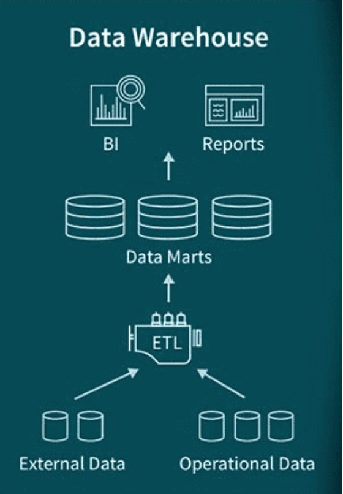
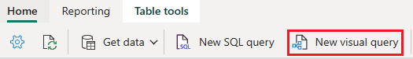
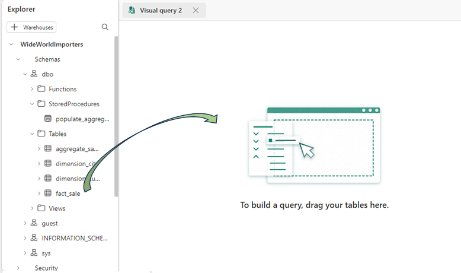

# Workshop: Microsoft Fabric Overview for the Data Professional

#### <i>A workshop from the Tales from the Field team</i>

<p style="border-bottom: 1px solid lightgrey;"></p>

<h2 id="04">04 - The Lakehouse and Warehouse</h2>

Microsoft Fabric gives data professionals two complementary ways to build analytics on OneLake: the **Lakehouse** and the **Warehouse**. Both store data in open Delta tables, both participate in SQL analytics, and both integrate with Power BI and the rest of Fabric. The difference is the development model and the workloads each one is designed for.

The **Lakehouse** is the natural home for data engineering and medallion architecture patterns. It stores structured, semi-structured, and unstructured data, manages reliable tables with Delta Lake, and uses Apache Spark (notebooks, starter and custom pools, Fabric runtimes, and environments) to transform data at scale. Curated tables are available to SQL and Power BI users through the SQL analytics endpoint without copying data.

The **Warehouse** is an enterprise-scale relational warehouse with a familiar T-SQL experience, full multi-table ACID transactions, and a SaaS **minimal knobs experience**. Autonomous workload management, transparent caching, automatic statistics, and automatic compaction and checkpointing deliver performance by default, and Copilot can help generate, complete, explain, and fix T-SQL using warehouse schema metadata.

In this module, you start with the Lakehouse and Spark: core concepts, loading and organizing data, Spark transformation, and operational patterns. You then move to the Warehouse: core concepts, ingestion and transformation, and advanced capabilities such as time travel, zero-copy table clones, custom SQL pools, and data clustering. Each concept is followed by a hands-on activity that asks you to make a design decision, build something, validate it, or explain how you would operate it in a real organization.

In each section you'll get more references, which you should follow up on to learn more. Also watch for links within the text - click on each one to explore that topic.

(<a href="00%20-%20Pre-Requisites.md">Make sure you check out the <b>Pre-Requisites</b> page before you start</a>. You'll need all of the items loaded there before you can proceed with the workshop.)

You'll cover these topics in this module:

<dl>

  <dt><a href="#4.1">4.1 - Understanding the Fabric Lakehouse</a></dt>
  <dt><a href="#4.2">4.2 - Loading and organizing lakehouse data</a></dt>
  <dt><a href="#4.3">4.3 - Transforming data with Spark notebooks</a></dt>
  <dt><a href="#4.4">4.4 - Operationalizing Lakehouse and Spark workloads</a></dt>
  <dt><a href="#4.5">4.5 - Understanding the Fabric Warehouse</a></dt>
  <dt><a href="#4.6">4.6 - Ingesting and transforming warehouse data</a></dt>
  <dt><a href="#4.7">4.7 - Working with time travel and table clones</a></dt>
  <dt><a href="#4.8">4.8 - Tuning advanced workloads with custom SQL pools and data clustering</a></dt>

</dl>

<p style="border-bottom: 1px solid lightgrey;"></p>

<h2 id="4.1">4.1 Understanding the Fabric Lakehouse</h2>

A lakehouse in Fabric combines the scalability of a data lake with warehouse-style querying. It stores data in OneLake, uses Delta Lake for reliable table storage, and supports analysis with both Apache Spark and SQL. The main idea is simple: keep one copy of data and let different engines and experiences work with it.

<p></p>

Use a Fabric Lakehouse when you need:

- A data engineering landing zone for raw, cleaned, and curated data.
- Support for structured, semi-structured, and unstructured data.
- Apache Spark for large-scale transformation, exploration, and data science.
- Delta Lake tables with ACID transactions, schema enforcement, and time travel.
- A medallion architecture with Bronze, Silver, and Gold layers.
- OneLake shortcuts to reference data without copying it.
- Read-only T-SQL access over Delta tables through the SQL analytics endpoint.
- Integration with notebooks, pipelines, Dataflow Gen2, Spark job definitions, semantic models, and Power BI.

Fabric Lakehouse and Fabric Warehouse both store data in Delta format on OneLake and both can participate in SQL analytics. The difference is the development model and workload pattern.

| Decision point | Lakehouse | Warehouse |
| --- | --- | --- |
| Primary development experience | Spark, notebooks, Spark SQL, Python, Scala, R | T-SQL |
| Data shape | Structured, semi-structured, and unstructured | Primarily structured |
| Best fit | Data engineering, data science, medallion architecture, large-scale transformations | Dimensional modeling, SQL-first analytics, governed BI marts |
| Write path | Spark, pipelines, Dataflows, shortcuts, event ingestion | T-SQL, pipelines, Dataflows, COPY INTO |
| SQL access | Read-only SQL analytics endpoint over Delta tables | Full warehouse SQL experience with DDL and DML |

The lakehouse also has two important storage areas:

| Area | Purpose | Typical content |
| --- | --- | --- |
| **Files** | Store raw, unstructured, semi-structured, or non-Delta files | CSV, JSON, Parquet, images, text files, landing data |
| **Tables** | Store managed Delta tables that Fabric can discover and expose | Bronze, Silver, and Gold Delta tables |

Only Delta tables in the Tables area are automatically available through the SQL analytics endpoint. Files are still useful, but they are usually raw material for a transformation process that creates Delta tables.

### Why the lakehouse is so useful

The lakehouse is not just a folder in a data lake. It is a Fabric item that connects storage, metadata, Spark, SQL, and analytics experiences.

| Capability | Why it matters |
| --- | --- |
| **One copy of data** | Different users and engines can work over the same data estate without unnecessary copies |
| **Delta Lake foundation** | ACID transactions, schema enforcement, table history, and reliable reads and writes make files behave more like managed data |
| **Spark and SQL access** | Data engineers can use notebooks and Spark while analysts can query curated Delta tables with T-SQL |
| **Shortcuts** | Existing data in OneLake, ADLS Gen2, Amazon S3, or other supported locations can appear in the lakehouse without copying it |
| **Schemas** | Tables can be organized by domain and referenced with names such as `sales.orders` or with cross-workspace namespaces |
| **Analyze data with** | The lakehouse can open data in notebook, SQL analytics endpoint, or other analysis experiences from one place |

### Learn more

- [What is a lakehouse?](https://learn.microsoft.com/en-us/fabric/data-engineering/lakehouse-overview)
- [Choose between Warehouse and Lakehouse](https://learn.microsoft.com/en-us/fabric/fundamentals/decision-guide-lakehouse-warehouse)
- [What is the SQL analytics endpoint for a lakehouse?](https://learn.microsoft.com/en-us/fabric/data-engineering/lakehouse-sql-analytics-endpoint)
- [OneLake shortcuts](https://learn.microsoft.com/en-us/fabric/onelake/onelake-shortcuts)
- [Lakehouse schemas](https://learn.microsoft.com/en-us/fabric/data-engineering/lakehouse-schemas)

<br>

<p><b>Activity: Explore the Lakehouse Shape</b></p>

Create or open a lakehouse and identify the parts that make it different from a traditional data lake folder.

<p><b>Steps</b></p>

- From the workspace, select **+ New item** and create a **Lakehouse**.
- Keep **Lakehouse schemas** enabled if the option is available in your environment.
- Open the Lakehouse explorer and identify the **Files** area and the **Tables** area.
- Create or identify at least one schema under **Tables**, such as `bronze`, `silver`, or `gold`.
- Explain what kind of data belongs in **Files** and what kind belongs in **Tables**.
- Open the **Analyze data with** menu and identify which experiences are available from your lakehouse.
- Switch to the SQL analytics endpoint and explain why it is read-only over lakehouse Delta tables.

<p style="border-bottom: 1px solid lightgrey;"></p>

<h2 id="4.2">4.2 Loading and organizing lakehouse data</h2>

Fabric gives you several ways to get data into a lakehouse. The right approach depends on the source, data volume, required transformations, and whether you want to physically copy data or reference it where it already lives.

Use this decision table when choosing a lakehouse ingestion pattern:

| Need | Recommended capability | Why |
| --- | --- | --- |
| Load a small local file with little or no transformation | **File upload** | Fastest way to land a small file in the lakehouse Files area |
| Reference existing data without copying it | **OneLake shortcut** | Creates a folder-like reference to data in another location while avoiding duplicate storage |
| Load and visually transform data with low code | **Dataflow Gen2** | Uses Power Query transformations and can output to lakehouse tables |
| Move data at scale from supported connectors | **Data Factory pipeline with Copy activity** | Best for repeatable, scheduled, or orchestrated movement into the lakehouse |
| Apply complex transformations or unsupported source logic | **Spark notebook** | Gives full programmatic control with Spark DataFrames, Spark SQL, Python, Scala, or R |
| Land real-time events into Delta tables | **Eventstream** | Routes streaming data to a lakehouse destination |

<p></p>

Lakehouse data is usually organized by processing stage. Many data engineering solutions use a medallion architecture:

| Layer | Purpose | Typical implementation |
| --- | --- | --- |
| **Bronze** | Raw or lightly validated source-aligned data | Files or Delta tables that preserve source detail |
| **Silver** | Cleaned, standardized, deduplicated, and conformed data | Delta tables transformed with Spark or Dataflow Gen2 |
| **Gold** | Business-ready curated data for reporting, models, and downstream consumption | Delta tables shaped for semantic models, SQL queries, and Power BI |

Schema-enabled lakehouses make this organization easier because tables can be grouped into named schemas such as `bronze`, `silver`, and `gold`. They also support cross-workspace Spark SQL references with a four-part namespace:

```sql
SELECT *
FROM ops_workspace.sales_lakehouse.silver.orders;
```

OneLake shortcuts are another important lakehouse concept. A shortcut appears as a folder in the lakehouse but points to data stored somewhere else. Shortcuts can reference internal OneLake data or supported external sources. In the Tables area, shortcuts are typically used for Delta tables. In the Files area, shortcuts can reference folders and files in many formats.

<p></p>

The key design choice is whether the data should be **copied**, **transformed**, or **referenced**.

| Design choice | Use when |
| --- | --- |
| **Copy** | You need a governed local copy, repeatable ingestion, or historical control |
| **Transform** | The source needs cleanup, standardization, enrichment, or reshaping |
| **Reference** | The data already exists in a governed location and you want to avoid duplication |

### Learn more

- [Data ingestion options for a lakehouse](https://learn.microsoft.com/en-us/fabric/data-engineering/load-data-lakehouse)
- [Load data into your lakehouse with a notebook](https://learn.microsoft.com/en-us/fabric/data-engineering/lakehouse-notebook-load-data)
- [OneLake shortcuts](https://learn.microsoft.com/en-us/fabric/onelake/onelake-shortcuts)
- [Lakehouse schemas](https://learn.microsoft.com/en-us/fabric/data-engineering/lakehouse-schemas)
- [Copy data using Copy activity](https://learn.microsoft.com/en-us/fabric/data-factory/copy-data-activity)

<br>

<p><b>Activity: Design a Lakehouse Loading Pattern</b></p>

Choose the right lakehouse loading approach for common data engineering scenarios.

<p><b>Steps</b></p>

- For each scenario, choose **file upload**, **shortcut**, **Dataflow Gen2**, **pipeline Copy activity**, **Spark notebook**, or **Eventstream**:
  - A small CSV file from a workshop lab needs to be loaded once.
  - A curated Delta table in another workspace should appear in this lakehouse without copying data.
  - A business analyst needs to clean an Excel or database source before landing it as a Delta table.
  - A source system needs a scheduled nightly copy into the Bronze layer.
  - A JSON feed requires custom parsing and multiple joins before becoming a Silver table.
  - A stream of telemetry events should land continuously in a lakehouse table.
- Create a simple schema plan for `bronze`, `silver`, and `gold`.
- Pick one scenario and implement the first step in your lakehouse.
- Explain whether your implementation copied, transformed, or referenced the data.
- Identify what should happen next before the data is ready for reporting.

<p style="border-bottom: 1px solid lightgrey;"></p>

<h2 id="4.3">4.3 Transforming data with Spark notebooks</h2>

Fabric notebooks are the primary interactive code item for Spark-based data engineering and data science. They provide a web-based authoring surface for code, Markdown, visualizations, and collaboration. Data professionals use notebooks to explore data, build transformations, create Delta tables, validate results, and prepare logic for scheduled execution.

<p></p>

Fabric notebooks can:

- Run Spark code with zero setup effort.
- Read and write lakehouse data with Spark APIs or Pandas APIs.
- Attach one or more lakehouses and pin a default lakehouse.
- Use relative lakehouse paths, ABFS paths, or the notebook-only `/lakehouse/default/` mount point.
- Generate code snippets from Lakehouse explorer actions.
- Use Markdown and visualizations to document and explain the data process.
- Use Copilot for context-aware code generation, refactoring, validation, and failed-cell repair when enabled.

<p></p>

The simplest Spark pattern is to read data, transform it as a DataFrame, and write it as a Delta table:

```python
source_path = "Files/raw/sales/orders.parquet"

orders_df = spark.read.parquet(source_path)

clean_orders_df = (
    orders_df
    .dropDuplicates(["SalesOrderID"])
    .filter("SalesAmount is not null")
    .withColumnRenamed("SalesOrderID", "sales_order_id")
)

clean_orders_df.write.mode("overwrite").format("delta").saveAsTable("silver.orders")
```

You can also use Spark SQL for transformations:

```sql
CREATE OR REPLACE TABLE gold.daily_sales
USING DELTA
AS
SELECT
    OrderDate,
    SUM(SalesAmount) AS TotalSales
FROM silver.orders
GROUP BY OrderDate;
```

For workshop purposes, focus on the pattern more than the specific sample data:

1. Land or reference source data.
2. Read the data into Spark.
3. Profile and validate the data.
4. Apply transformations.
5. Save the result as a Delta table in the correct schema or layer.
6. Query the result with Spark SQL or the SQL analytics endpoint.

### Spark compared with SQL endpoint

| Need | Use Spark notebook | Use SQL analytics endpoint |
| --- | --- | --- |
| Write, update, transform, or create Delta tables | Yes | No, read-only |
| Use Python, Scala, R, or Spark SQL | Yes | No |
| Build complex data engineering logic | Yes | Limited |
| Query curated Delta tables with T-SQL | No, unless using Spark SQL instead | Yes |
| Create views or stored procedures for SQL users | No | Yes |

The lakehouse lets both experiences work together. Spark is the write and transformation engine. The SQL analytics endpoint is the read-only SQL consumption surface over Delta tables.

### Learn more

- [How to use notebooks](https://learn.microsoft.com/en-us/fabric/data-engineering/how-to-use-notebook)
- [Load data into your lakehouse with a notebook](https://learn.microsoft.com/en-us/fabric/data-engineering/lakehouse-notebook-load-data)
- [Explore the data in your lakehouse with a notebook](https://learn.microsoft.com/en-us/fabric/data-engineering/lakehouse-notebook-explore)
- [What is the SQL analytics endpoint for a lakehouse?](https://learn.microsoft.com/en-us/fabric/data-engineering/lakehouse-sql-analytics-endpoint)
- [Apache Spark runtime in Fabric](https://learn.microsoft.com/en-us/fabric/data-engineering/runtime)

<br>

<p><b>Activity: Build a Bronze to Silver Spark Transformation</b></p>

Create a notebook that reads raw lakehouse data and writes a cleaned Delta table.

<p><b>Steps</b></p>

- From the lakehouse, create a new notebook or open an existing notebook.
- Attach the lakehouse and pin it as the default lakehouse.
- Load a small dataset from **Files** or an existing Bronze table.
- Use Spark to inspect the schema and preview rows.
- Apply at least three transformations, such as:
  - Rename columns to a consistent convention.
  - Cast data types.
  - Remove duplicate rows.
  - Filter invalid records.
  - Add a derived column.
  - Join to a lookup dataset.
- Save the output as a Delta table in a `silver` schema or with a clear Silver table name.
- Query the result with Spark SQL.
- Switch to the SQL analytics endpoint and confirm whether the Delta table is visible for read-only SQL querying.
- Explain what additional work would be needed to create a Gold table for reporting.

<p style="border-bottom: 1px solid lightgrey;"></p>

<h2 id="4.4">4.4 Operationalizing Lakehouse and Spark workloads</h2>

Interactive notebooks are a great way to learn and develop, but production lakehouse solutions also need repeatable execution, reliable compute, managed libraries, monitoring, and table maintenance.

Fabric Spark compute gives you two main pool patterns:

| Compute option | Best fit | Notes |
| --- | --- | --- |
| **Starter pools** | Fast interactive notebook work | Preconfigured, Microsoft-managed Spark sessions that can often start in seconds when prewarmed capacity is available |
| **Custom Spark pools** | Larger, specialized, or predictable workloads | Let workspace admins choose node size, autoscale behavior, and related compute settings |

Starter pools are great for workshops because they reduce the time between opening a notebook and running Spark code. Custom pools are more relevant when a workload needs a specific size, predictable behavior, or a different compute profile. For latency-sensitive scheduled jobs, custom live pools can keep clusters warm during an active window.

Fabric Spark runtime and environments are equally important:

| Capability | Why it matters |
| --- | --- |
| **Fabric Runtime** | Defines Spark, Python, Scala, Java, Delta Lake, and Fabric optimization versions |
| **Native Execution Engine** | Can accelerate supported Spark operators through a vectorized native path without code changes |
| **Environments** | Package runtime version, Spark settings, and libraries for notebooks and Spark job definitions |
| **Library management** | Lets teams manage built-in, public, private, Maven, and custom libraries in a controlled way |

When logic is ready for production, choose the right execution pattern:

| Need | Recommended operational pattern |
| --- | --- |
| Run notebook logic on a schedule or as part of orchestration | Notebook activity in a Data Factory pipeline or notebook schedule |
| Run compiled Python, Java, or Scala Spark applications | Spark job definition |
| Chain ingestion, transformation, validation, maintenance, and notifications | Data Factory pipeline |
| Reuse dependencies and Spark settings consistently | Fabric environment |
| Keep Delta tables healthy | Lakehouse table maintenance activity or scheduled maintenance process |

Lakehouse maintenance keeps Delta tables healthy over time. Maintenance can compact small files, apply V-order optimization, run VACUUM to remove obsolete files beyond the retention threshold, and improve read performance. For recurring production workloads, use pipeline-based maintenance so it runs after major ingestion or transformation steps.

Security context also matters. A notebook runs under different identities depending on how it is triggered:

| Trigger | Execution identity |
| --- | --- |
| Interactive run | Current user |
| Pipeline notebook activity | Pipeline's last modified user |
| Schedule | User who created or last updated the schedule |

This is important because the identity determines data access, API authorization, and permissions. Before operationalizing notebooks, review who last modified the notebook and pipeline, what data the run accesses, and whether the execution identity has the right permissions.

### Learn more

- [Apache Spark compute for Data Engineering and Data Science](https://learn.microsoft.com/en-us/fabric/data-engineering/spark-compute)
- [Apache Spark runtime in Fabric](https://learn.microsoft.com/en-us/fabric/data-engineering/runtime)
- [Manage libraries in Fabric environments](https://learn.microsoft.com/en-us/fabric/data-engineering/environment-manage-library)
- [Apache Spark job definition](https://learn.microsoft.com/en-us/fabric/data-engineering/spark-job-definition)
- [Delta table maintenance in Microsoft Fabric](https://learn.microsoft.com/en-us/fabric/data-engineering/lakehouse-table-maintenance)

<br>

<p><b>Activity: Productionize a Spark Transformation</b></p>

Take the notebook pattern from the previous activity and decide how it should run in a production lakehouse solution.

<p><b>Steps</b></p>

- Identify the notebook or transformation logic that creates your Silver table.
- Decide whether it should remain a notebook, become a Spark job definition, or run inside a Data Factory pipeline.
- Identify the compute pattern: starter pool, custom Spark pool, or custom live pool.
- Identify whether the workload needs a Fabric environment for libraries, runtime selection, or Spark properties.
- Add or describe a pipeline step that would run after the transformation, such as validation, SQL endpoint refresh, table maintenance, or notification.
- Review the execution identity that would run the job.
- Explain how you would monitor success, failure, runtime, and data quality.
- Explain when you would run table maintenance and why it should usually happen after major ingestion or update activity.

<p style="border-bottom: 1px solid lightgrey;"></p>

<h2 id="4.5">4.5 Understanding the Fabric Warehouse</h2>

Fabric Data Warehouse is a lake warehouse: a relational warehouse experience built on Fabric's open data foundation. Warehouse data is stored in Delta tables, which use Parquet files plus a transaction log. That means warehouse data can participate in the broader Fabric ecosystem while still giving SQL developers a familiar relational development surface.

Use a Fabric Warehouse when you need:

- Curated corporate data marts.
- Star or snowflake schemas.
- Governed business intelligence models.
- T-SQL-based development, transformation, and querying.
- Full DDL and DML support for warehouse tables.
- Multi-table ACID transactions.
- Stored procedures, functions, views, materialized views, and SQL security.
- Direct integration with Power BI and other SQL client tools.

<p></p>

Fabric also creates SQL analytics endpoints for Lakehouses, SQL databases, and OneLake-backed data. The distinction matters:

| Item | Best fit | What you can do |
| --- | --- | --- |
| **Warehouse** | Enterprise relational warehouse workloads | Create and modify tables, load data, transform data with T-SQL, manage warehouse objects, and serve governed analytics |
| **SQL analytics endpoint** | SQL access over Lakehouse or other OneLake-backed data | Query Delta tables, create SQL objects such as views and procedures, and apply SQL security over data managed elsewhere |

The big shift for data professionals is that many traditional warehouse administration concerns are handled for you.

| Capability | Why it matters |
| --- | --- |
| **Minimal knobs experience** | Fabric provides autonomous workload management, separated storage and compute, and a SaaS operating model so you can focus on data design and business logic |
| **Performance by default** | The distributed SQL engine, transparent caching, automatically maintained statistics, and query optimization reduce the amount of manual tuning needed before workloads run well |
| **Automatic maintenance** | Warehouse transactions use Delta files and logs; Fabric automatically supports table health through capabilities such as compaction, checkpointing, statistics maintenance, and retention-backed history |
| **Open data foundation** | Warehouse data lives in Delta tables in OneLake, which helps different Fabric workloads collaborate over the same data estate |
| **AI-assisted development** | Copilot can generate T-SQL from natural language, suggest code completions, explain SQL, and help fix query issues from the Fabric SQL editor |

This does not mean design no longer matters. Good schemas, appropriate data types, clear naming, useful relationships, and thoughtful load patterns still matter. The difference is that Fabric starts you from a managed, performance-oriented foundation instead of making you assemble every operational detail yourself.

<p></p>

<p></p>

### Learn more

- [What is Fabric Data Warehouse?](https://learn.microsoft.com/en-us/fabric/data-warehouse/data-warehousing)
- [Performance guidelines for Fabric Data Warehouse](https://learn.microsoft.com/en-us/fabric/data-warehouse/guidelines-warehouse-performance)
- [Microsoft Copilot in the Data Warehouse workload](https://learn.microsoft.com/en-us/fabric/data-warehouse/copilot)
- [Choose between Warehouse and Lakehouse](https://learn.microsoft.com/en-us/fabric/fundamentals/decision-guide-lakehouse-warehouse)

<br>

<p><b>Activity: Explain Why Warehouse Is Different</b></p>

Create or open a Fabric Warehouse and explain why it is different from a traditional warehouse platform.

<p><b>Steps</b></p>

- From the workspace, select **+ New item** and create a **Warehouse**.
- Open the warehouse and identify the main authoring surfaces available to you, such as the SQL query editor, visual query editor, object explorer, model view, and reporting options.
- Create or identify a small table that can be used for later module activities.
- Write down three things you did not have to configure before using the warehouse, such as distribution keys, manual compute sizing for a table, cache configuration, or statistics jobs.
- Explain why a minimal knobs experience is valuable for a data professional building a workshop solution.
- If Copilot is enabled in your tenant, ask Copilot to generate a simple query against your warehouse schema. Review the generated SQL before running it.

You can also right-click this link to open it in another tab and review this video that introduces you to these concepts:

<p><a href="https://www.youtube.com/watch?v=StIBBb69wDw"></a></p>

<p style="border-bottom: 1px solid lightgrey;"></p>

<h2 id="4.6">4.6 Ingesting and transforming warehouse data</h2>

A Fabric Warehouse can be populated through code-free, low-code, and code-rich experiences. This is one of the reasons it works well in a data professional workshop: the ingestion pattern can match the author and the scenario.

Use this decision table when choosing how to load data into a warehouse:

| Need | Recommended capability | Why |
| --- | --- | --- |
| Orchestrated ingestion from many source systems with scheduling, validation, branching, or follow-up activities | **Data Factory pipeline with Copy activity** | Best when loading the warehouse is one step in a repeatable workflow |
| Guided movement into the warehouse without designing a full pipeline first | **Copy job** | Best when data movement is the main task and you want a simple authoring experience |
| Low-code shaping before loading | **Dataflow Gen2** | Best when data needs cleanup, type changes, derived columns, joins, or other Power Query transformations before landing |
| High-throughput file-based ingestion from Azure Storage or OneLake using SQL | **COPY INTO** | Best when SQL developers want to load staged CSV, JSONL, or Parquet files as part of a T-SQL process |
| Query files in external storage before deciding whether to load them | **OPENROWSET** | Best for exploration or occasional access to Parquet, CSV, or JSONL files in Azure Data Lake or Blob Storage |
| Load or transform data from Lakehouses, mirrored databases, or other warehouses in the same workspace | **Cross-database T-SQL queries** | Best when the source data is already in Fabric and can be referenced with three-part names |

Fabric Warehouse supports both ingestion and transformation from T-SQL. For example, SQL developers can use `INSERT...SELECT`, `SELECT INTO`, or `CREATE TABLE AS SELECT` to create warehouse tables from data in another warehouse, a Lakehouse SQL analytics endpoint, a mirrored database, or external files exposed through `OPENROWSET`.

The important design question is where each part of the work belongs:

| Work type | Good location |
| --- | --- |
| Extracting from operational systems | Data Factory pipeline or Copy job |
| Low-code preparation and shaping | Dataflow Gen2 |
| High-throughput file loading | `COPY INTO` |
| Warehouse modeling and dimensional transformations | T-SQL in the Warehouse |
| Joining Fabric items in the same workspace | Cross-database query |
| Reusable warehouse business logic | Views, stored procedures, functions, and CTAS patterns |

For warehouse transformation, favor set-based operations. Avoid row-at-a-time singleton insert patterns for large loads. Use SQL transformations that operate over sets of data, and use clear staging and curated schemas so participants can see how raw loaded data becomes business-ready warehouse tables.

### Example: Cross-database transformation

The following pattern creates a new table in a warehouse by reading from another Fabric item in the same workspace:

```sql
CREATE TABLE dbo.FactSales
AS
SELECT
    s.SalesOrderID,
    s.OrderDate,
    s.CustomerID,
    s.ProductID,
    s.Quantity,
    s.SalesAmount
FROM SalesLakehouse.dbo.SalesOrders AS s
WHERE s.OrderDate >= '2025-01-01';
```

### Example: Loading staged files with COPY INTO

The following pattern loads files from OneLake or Azure storage into an existing warehouse table:

```sql
COPY INTO dbo.SalesOrders
FROM 'https://onelake.dfs.fabric.microsoft.com/<workspace-id>/<item-id>/Files/orders/*.csv'
WITH (
    FILE_TYPE = 'CSV',
    FIRSTROW = 2,
    CREDENTIAL = (IDENTITY = 'Workspace Identity')
);
```

### Learn more

- [Ingest data into the Warehouse](https://learn.microsoft.com/en-us/fabric/data-warehouse/ingest-data)
- [Ingest data into your Warehouse using pipelines](https://learn.microsoft.com/en-us/fabric/data-warehouse/ingest-data-pipelines)
- [Ingest data using the COPY statement](https://learn.microsoft.com/en-us/fabric/data-warehouse/ingest-data-copy)
- [Ingest data into your Warehouse using Transact-SQL](https://learn.microsoft.com/en-us/fabric/data-warehouse/ingest-data-tsql)
- [Query the Warehouse or SQL analytics endpoint](https://learn.microsoft.com/en-us/fabric/data-warehouse/query-warehouse)

<br>

<p><b>Activity: Choose a Warehouse Ingestion and Transformation Pattern</b></p>

Choose an ingestion and transformation pattern for several warehouse scenarios, then implement one of them.

<p><b>Steps</b></p>

- For each scenario, choose **Data Factory pipeline**, **Copy job**, **Dataflow Gen2**, **COPY INTO**, **OPENROWSET**, or **cross-database query**:
  - A source system must load new warehouse data every night, then run validation and send a notification.
  - A CSV file has been staged in OneLake and a SQL developer wants to load it quickly into a warehouse table.
  - A Lakehouse table in the same workspace needs to become a curated warehouse fact table.
  - A business analyst needs to clean and standardize customer data before loading it.
  - A data engineer wants to inspect a few external Parquet files before deciding whether they should become warehouse tables.
- Pick one scenario and implement the first version in your workshop environment.
- Create a simple staging table and a curated table, or identify equivalent tables that already exist.
- Use a set-based SQL transformation to move data from staging to curated.
- Explain why the ingestion pattern and the transformation pattern are not always the same decision.

<p style="border-bottom: 1px solid lightgrey;"></p>

<h2 id="4.7">4.7 Working with time travel and table clones</h2>

Modern warehouse development needs safe ways to compare, recover, test, and reproduce results. Fabric Warehouse supports this through time travel and zero-copy table clones.

**Time travel** lets you query data as it existed at a previous point in time within the configured retention period. It is useful for stable reporting, auditing, troubleshooting, historical comparison, and reproducing prior analytical or machine learning results.

You can query prior data with the `FOR TIMESTAMP AS OF` query hint:

```sql
SELECT *
FROM dbo.DimCustomer
OPTION (FOR TIMESTAMP AS OF '2026-09-30T20:00:00.000');
```

Time travel queries are read-only. The timestamp is expressed in UTC, and the capability is limited by the warehouse data retention period. The default warehouse retention period is 30 calendar days and can be configured based on organizational needs.

**Table clones** let you create near-instantaneous, zero-copy copies of tables with minimal storage cost. A clone copies table metadata while referencing the same underlying data files in OneLake. After creation, the clone is separate and independent from the source table: changes to the source are not reflected in the clone, and changes to the clone are not reflected in the source.

Use table clones when you need:

- A safe development or testing copy of production-like data.
- A point-in-time reporting snapshot.
- A recovery option after a failed release or bad data load.
- A low-cost way to compare current and historical table states.
- A reproducible dataset for experimentation.

You can create a clone from the current table state or from a previous point in time within the retention period:

```sql
CREATE TABLE dbo.DimCustomer_BeforeRelease
AS CLONE OF dbo.DimCustomer;
```

The big idea is that time travel helps you **query the past**, while cloning helps you **materialize a safe working copy** of a current or past table state.

### Learn more

- [Time travel in Fabric Data Warehouse](https://learn.microsoft.com/en-us/fabric/data-warehouse/time-travel)
- [Query using time travel](https://learn.microsoft.com/en-us/fabric/data-warehouse/how-to-query-using-time-travel)
- [Clone table in Fabric Data Warehouse](https://learn.microsoft.com/en-us/fabric/data-warehouse/clone-table)
- [Tutorial: Clone a table with T-SQL in a Warehouse](https://learn.microsoft.com/en-us/fabric/data-warehouse/tutorial-clone-table)
- [Configurable data retention](https://learn.microsoft.com/en-us/fabric/data-warehouse/data-retention)

<br>

<p><b>Activity: Protect a Warehouse Change</b></p>

Use time travel and cloning concepts to design a safer release process for a warehouse table.

<p><b>Steps</b></p>

- Choose a warehouse table that represents an important reporting object, such as a dimension or fact table.
- Identify a risky change you might make to that table, such as a data correction, schema change, or transformation update.
- Before making the change, create a table clone or write down the clone statement you would use in production.
- Run a query against the original table and the clone to confirm that the clone has the expected data.
- Make a small safe change to the original table in your workshop environment, or describe the change if your environment should remain read-only.
- Explain how time travel could help compare the table before and after the change.
- Explain when you would use a clone instead of only relying on time travel.

You can also right-click this link to open it in another tab and review this video that introduces you to these concepts:

<p><a href="https://www.youtube.com/watch?v=-VXiEEIS2wc"></a></p>

<p style="border-bottom: 1px solid lightgrey;"></p>

<h2 id="4.8">4.8 Tuning advanced workloads with custom SQL pools and data clustering</h2>

Fabric Warehouse is designed to require fewer knobs, but advanced workloads still need design choices. Two important capabilities are custom SQL pools and data clustering.

**Custom SQL pools** are a preview workload management capability for warehouses and SQL analytics endpoints. By default, Fabric Warehouse uses autonomous workload management and separates work into internal SQL pools for ingestion and query processing. Custom SQL pools let administrators create more isolation boundaries and control how backend compute resources are allocated to different workload classes.

Use custom SQL pools when you need to:

- Protect a critical reporting application from ad hoc user queries.
- Reduce resource competition between distinct workloads.
- Limit the maximum resource percentage available to a heavy workload.
- Classify requests by application name or application name pattern.
- Monitor pressure through Query Insights views such as `queryinsights.sql_pool_insights`.

Custom SQL pools are not the first tuning step for every warehouse. They are an advanced control for cases where workload isolation matters more than the default autonomous behavior.

**Data clustering** is a preview table design capability that physically organizes rows with similar column values close together during ingestion. This can improve query performance and reduce compute and storage access costs because the warehouse engine can skip files and row groups that do not match query predicates.

Data clustering is most useful when:

- The table is large.
- Queries repeatedly filter on the same columns.
- Filter columns have mid-to-high cardinality.
- Queries are selective and usually target a narrow slice of the table.
- The clustering columns are chosen from actual dashboard, report, scheduled job, or user query patterns.

Data clustering is defined when the table is created by using `CLUSTER BY`. It can use up to four supported columns.

```sql
CREATE TABLE dbo.FactSales
(
    SalesOrderID int,
    OrderDate date,
    CustomerID int,
    ProductID int,
    SalesAmount decimal(18,2)
)
WITH (CLUSTER BY (OrderDate, CustomerID));
```

Clustering is not a replacement for good modeling. Do not add clustering columns just because they exist. Choose them because the workload repeatedly filters on them and the table is large enough to benefit from file skipping.

### Custom SQL pools compared with data clustering

| Capability | Solves this problem | Design question |
| --- | --- | --- |
| **Custom SQL pools** | Workload isolation and resource allocation | Which applications or tools should get separate compute boundaries? |
| **Data clustering** | Reducing scans for selective predicates on large tables | Which columns are repeatedly used to filter large tables? |

### Learn more

- [Custom SQL pools in Fabric Data Warehouse](https://learn.microsoft.com/en-us/fabric/data-warehouse/custom-sql-pools)
- [Configure custom SQL pools in the Fabric portal](https://learn.microsoft.com/en-us/fabric/data-warehouse/configure-custom-sql-pools-portal)
- [Data clustering in Fabric Data Warehouse](https://learn.microsoft.com/en-us/fabric/data-warehouse/data-clustering)
- [Tutorial: Use data clustering in Fabric Data Warehouse](https://learn.microsoft.com/en-us/fabric/data-warehouse/tutorial-data-clustering)
- [Performance guidelines for Fabric Data Warehouse](https://learn.microsoft.com/en-us/fabric/data-warehouse/guidelines-warehouse-performance)

<br>

<p><b>Activity: Diagnose an Advanced Warehouse Workload</b></p>

Decide whether a performance or concurrency issue should be addressed with schema design, data clustering, workload isolation, or simpler query tuning.

<p><b>Steps</b></p>

- Review the following scenarios and choose the best response:
  - A large fact table is queried by date range thousands of times per day.
  - A dashboard slows down whenever users run expensive ad hoc queries from SQL query editor.
  - A query is slow only the first time it runs after a period of inactivity.
  - A table is filtered on a low-cardinality column such as `Region` and only has a small number of rows.
  - A CTAS process creates a large table that is later queried mostly by `OrderDate` and `CustomerID`.
- For each scenario, choose one of these responses: **data clustering**, **custom SQL pool**, **wait for warm cache and review Query Insights**, **schema/query design change**, or **no advanced feature needed yet**.
- If your environment has a large enough table, identify one candidate clustering column based on actual `WHERE` predicates.
- Write the `CREATE TABLE` or CTAS pattern you would use to create a clustered replacement table.
- Explain why Fabric starts with minimal knobs but still gives advanced controls for workloads that need them.

<p style="border-bottom: 1px solid lightgrey;"></p>

## Module wrap-up

In this module, you worked through the Lakehouse and Warehouse layers of a Fabric solution:

- You explained how the Lakehouse combines OneLake storage, Delta Lake reliability, Spark transformation, and SQL consumption, and compared Lakehouse and Warehouse design centers.
- You organized lakehouse data with Files, Tables, schemas, and medallion layers, and selected ingestion patterns including upload, shortcuts, Dataflow Gen2, pipelines, notebooks, and Eventstream.
- You transformed data with Spark notebooks into curated Delta tables and planned production execution with Spark compute, environments, Spark job definitions, pipelines, and table maintenance.
- You explored how the Warehouse pairs a familiar T-SQL experience with a minimal knobs, performance-by-default foundation and Copilot-assisted authoring.
- You compared warehouse ingestion options, including Data Factory, Dataflow Gen2, `COPY INTO`, `OPENROWSET`, and cross-database queries, and used set-based T-SQL to build curated tables.
- You explored advanced warehouse features: time travel, zero-copy clones, custom SQL pools, and data clustering.

The key takeaway is that the Lakehouse and Warehouse are complementary choices over the same open Delta foundation. Use the lakehouse as the data engineering center of gravity for flexible storage, Spark-powered transformation, and medallion architecture. Use the warehouse for a SQL-first, governed relational experience with minimal administration, and reach for its advanced capabilities when they match a real problem.

<p><b>For Further Study</b></p>

- [What is a lakehouse?](https://learn.microsoft.com/en-us/fabric/data-engineering/lakehouse-overview)
- [Data ingestion options for a lakehouse](https://learn.microsoft.com/en-us/fabric/data-engineering/load-data-lakehouse)
- [Lakehouse schemas](https://learn.microsoft.com/en-us/fabric/data-engineering/lakehouse-schemas)
- [OneLake shortcuts](https://learn.microsoft.com/en-us/fabric/onelake/onelake-shortcuts)
- [How to use notebooks](https://learn.microsoft.com/en-us/fabric/data-engineering/how-to-use-notebook)
- [Load data into your lakehouse with a notebook](https://learn.microsoft.com/en-us/fabric/data-engineering/lakehouse-notebook-load-data)
- [What is the SQL analytics endpoint for a lakehouse?](https://learn.microsoft.com/en-us/fabric/data-engineering/lakehouse-sql-analytics-endpoint)
- [Apache Spark compute for Data Engineering and Data Science](https://learn.microsoft.com/en-us/fabric/data-engineering/spark-compute)
- [Apache Spark runtime in Fabric](https://learn.microsoft.com/en-us/fabric/data-engineering/runtime)
- [Manage libraries in Fabric environments](https://learn.microsoft.com/en-us/fabric/data-engineering/environment-manage-library)
- [Apache Spark job definition](https://learn.microsoft.com/en-us/fabric/data-engineering/spark-job-definition)
- [Delta table maintenance in Microsoft Fabric](https://learn.microsoft.com/en-us/fabric/data-engineering/lakehouse-table-maintenance)
- [What is Fabric Data Warehouse?](https://learn.microsoft.com/en-us/fabric/data-warehouse/data-warehousing)
- [Create a Warehouse in Microsoft Fabric](https://learn.microsoft.com/en-us/fabric/data-warehouse/create-warehouse)
- [Ingest data into the Warehouse](https://learn.microsoft.com/en-us/fabric/data-warehouse/ingest-data)
- [Query the Warehouse or SQL analytics endpoint](https://learn.microsoft.com/en-us/fabric/data-warehouse/query-warehouse)
- [Performance guidelines for Fabric Data Warehouse](https://learn.microsoft.com/en-us/fabric/data-warehouse/guidelines-warehouse-performance)
- [Microsoft Copilot in the Data Warehouse workload](https://learn.microsoft.com/en-us/fabric/data-warehouse/copilot)
- [Time travel in Fabric Data Warehouse](https://learn.microsoft.com/en-us/fabric/data-warehouse/time-travel)
- [Clone table in Fabric Data Warehouse](https://learn.microsoft.com/en-us/fabric/data-warehouse/clone-table)
- [Custom SQL pools in Fabric Data Warehouse](https://learn.microsoft.com/en-us/fabric/data-warehouse/custom-sql-pools)
- [Data clustering in Fabric Data Warehouse](https://learn.microsoft.com/en-us/fabric/data-warehouse/data-clustering)

Congratulations! You have completed this Module. If you understand the concepts here and have completed all of the Activities, you can [proceed to the next Module](05%20-%20Introduction%20to%20Mirroring%20in%20Fabric.md).